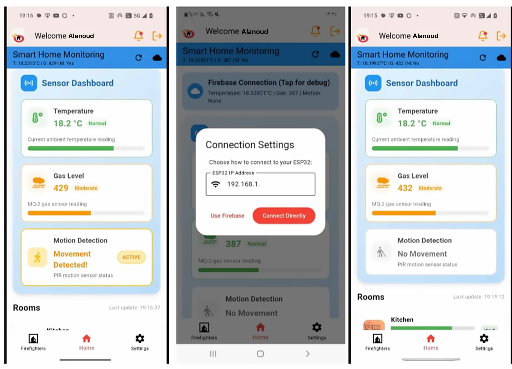
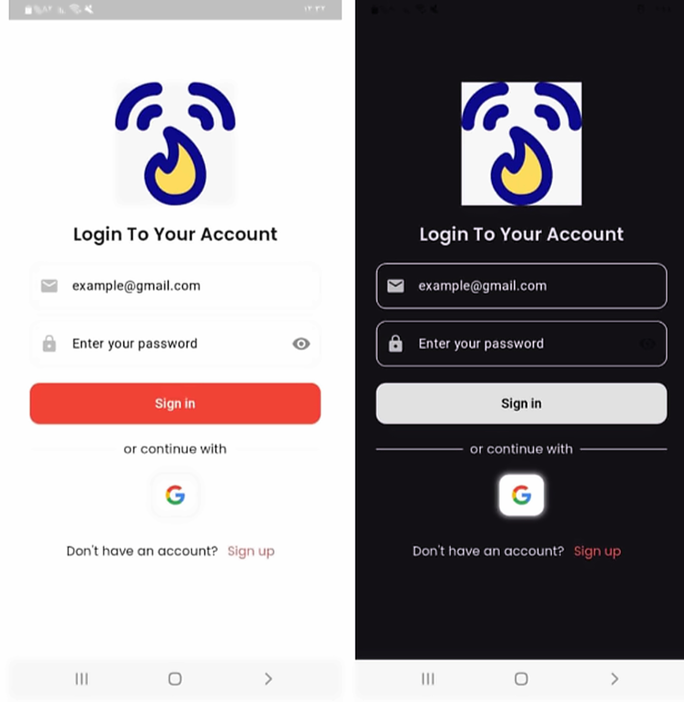
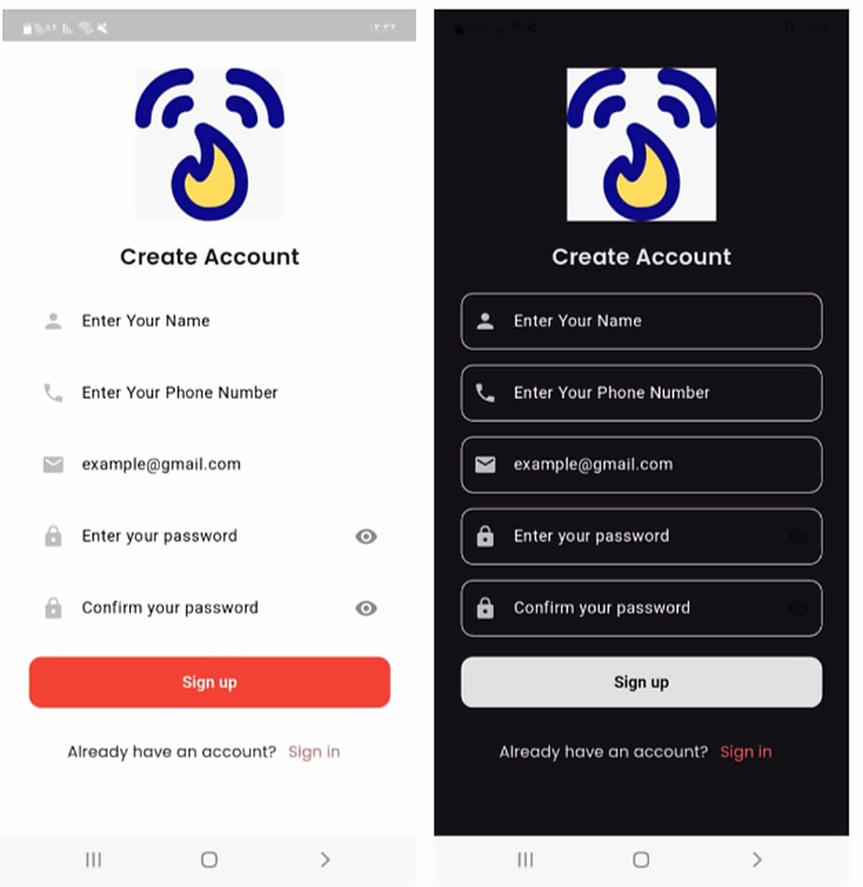
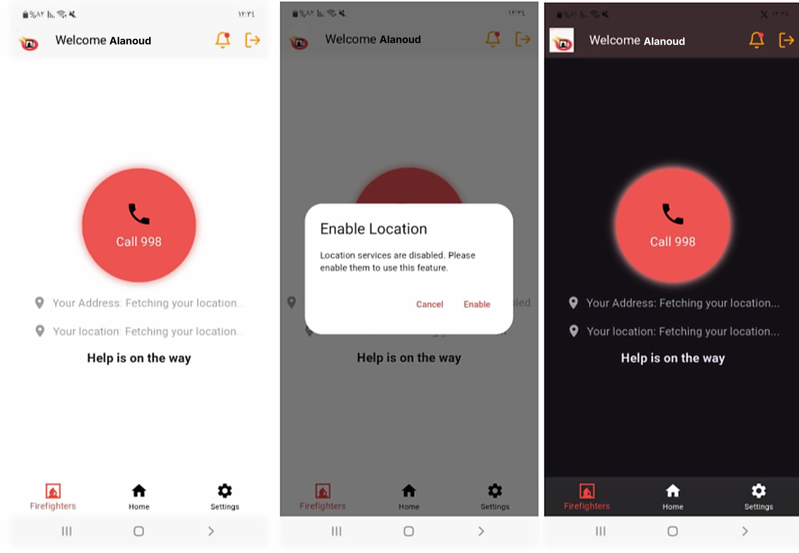
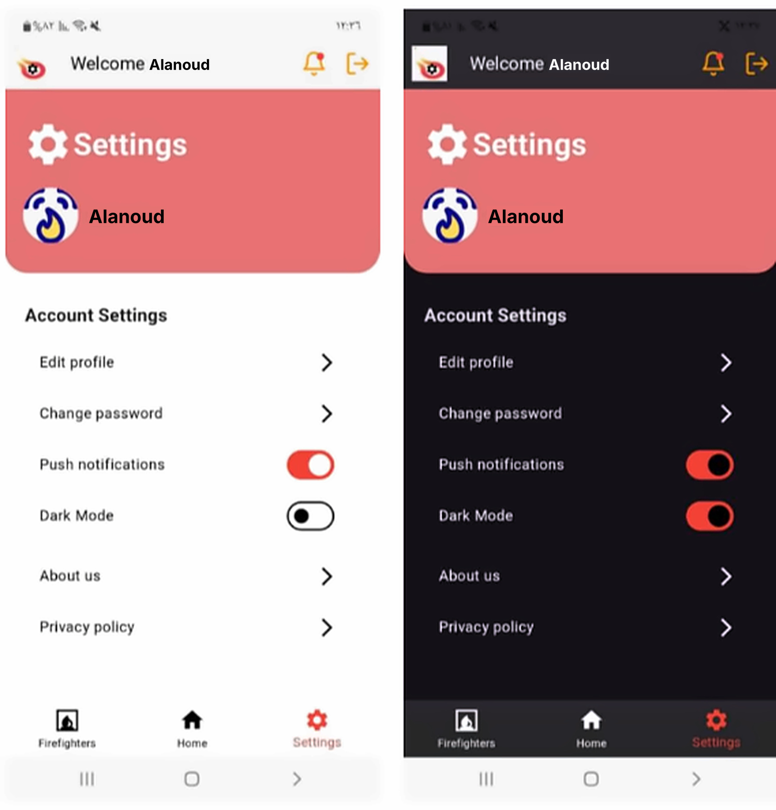
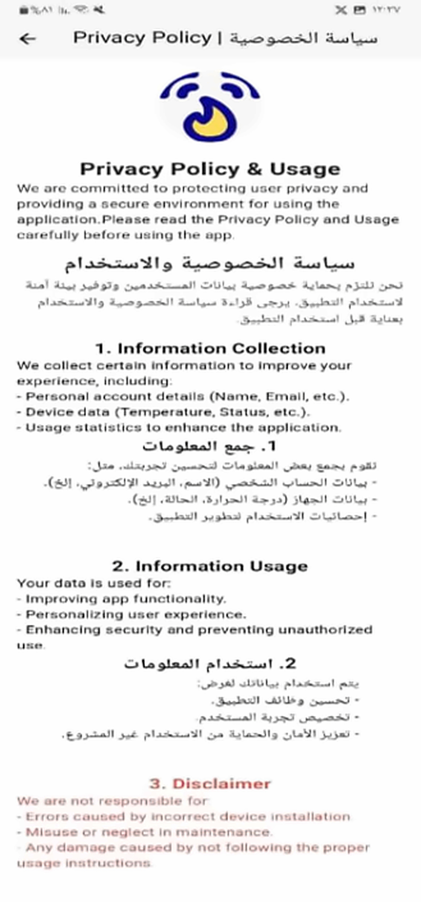
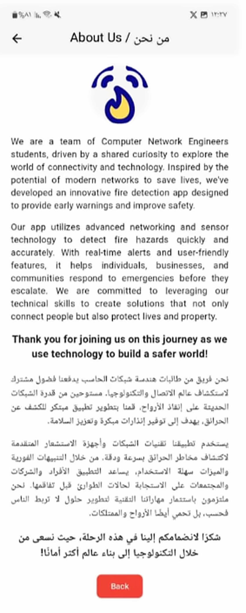

# 🔥 Wireless Fire Safety: A Proactive IoT Approach

An IoT-Based Fire Safety Monitoring System Using ESP32, Firebase, and Flutter.

---

## 📌 About the Project

Wireless Fire Safety is an Internet of Things (IoT) project designed to monitor environmental conditions and help identify potential fire hazards.

The system uses an ESP32 microcontroller connected to gas, temperature, and motion sensors. Sensor readings are transmitted wirelessly to Firebase Realtime Database and displayed through an Android mobile application developed using Flutter and Dart.

## 🎯 Project Objectives

- Monitor environmental conditions using connected sensors.
- Measure temperature and gas levels and detect motion.
- Transmit sensor readings wirelessly using ESP32.
- Store and synchronize sensor data through Firebase.
- Display monitoring information in a mobile application.
- Support awareness of potentially hazardous conditions.

---

## ⚙️ System Components

| Component | Function |
|:--|:--|
| ESP32 | Collects sensor readings and manages Wi-Fi communication. |
| MQ-2 Gas Sensor | Measures gas sensor readings. |
| TMP36 Temperature Sensor | Measures environmental temperature. |
| PIR Motion Sensor | Detects movement in the monitored area. |
| Firebase Realtime Database | Stores and synchronizes sensor data. |
| Android Mobile Application | Displays sensor readings and monitoring information. |

---

## 🏗️ System Architecture

The system connects the physical sensors to a cloud database and a mobile application.

System Workflow:

Sensors → ESP32 → Wi-Fi → Firebase Realtime Database → Android Application

---

## 🔄 How It Works

1. Data Collection

The ESP32 reads measurements from the gas, temperature, and motion sensors.

2. Data Processing

The system processes sensor readings and categorizes gas levels.

3. Wireless Communication

The ESP32 connects to Wi-Fi and transmits sensor readings to Firebase.

4. Cloud Database

Firebase Realtime Database stores and synchronizes the received data.

5. Mobile Monitoring

The Android application retrieves available sensor data and presents it through the user interface.

---

## 📱 Mobile Application

The mobile application provides an interface for monitoring sensor readings, managing account settings, and accessing safety-related features.

### 🏠 Dashboard

### 🔐 Login

### 📝 Create Account

### 🚨 Emergency Call

### ⚙️ Settings

### 👤 Profile

### 🔑 Change Password

### 🔒 Privacy Policy

### ℹ️ About Us

---

## 🛠️ Technologies Used

### Hardware
- ESP32 Microcontroller
- MQ-2 Gas Sensor
- TMP36 Temperature Sensor
- PIR Motion Sensor

### Software & Development
- Arduino IDE — Embedded system development
- C++ — ESP32 programming
- Flutter — Mobile application framework
- Dart — Mobile application programming language
- Firebase Realtime Database — Cloud data storage and synchronization
- Wi-Fi — Wireless communication

---

## 🎓 Project Information

| Detail | Description |
|:--|:--|
| Project Type | Graduation Project |
| Project Title | Wireless Fire Safety: A Proactive IoT Approach |
| Domain | Internet of Things (IoT) |
| Application Platform | Android |
| Database | Firebase Realtime Database |

---

## 💡 Project Significance

This project demonstrates how IoT technology can connect physical sensors, cloud-based data storage, and a mobile application to support environmental monitoring and fire safety awareness.
